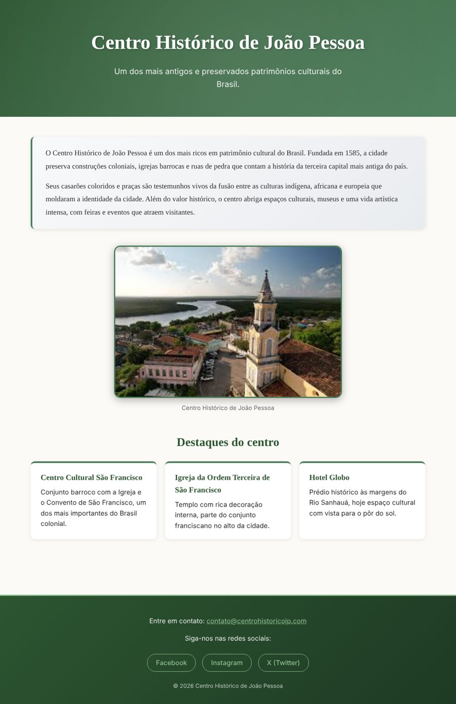

[](https://github.com/JOAOVICTORSOARESDELIMA/Projeto-Js-React/actions/workflows/ci.yml)

# Centro Histórico de João Pessoa: site em React

Avaliação da disciplina de **Tecnologia para Front-end Avançado** do curso de Sistemas para Internet (UNIESP, 2025.2). É uma página sobre o Centro Histórico de João Pessoa, construída com **React** e **Vite** e dividida em componentes reutilizáveis.



## O que o projeto mostra

- **Componentes funcionais** com responsabilidade única: `Cabecalho`, `Corpo`, `PontoTuristico` e `Rodape`
- **Props**: os componentes não têm texto fixo e recebem o conteúdo de quem os usa
- **Renderização de listas** com `.map()` e `key` (parágrafos, pontos turísticos e redes sociais)
- **Conteúdo separado da interface** em `src/data/conteudo.js`. Para trocar um texto, não precisa mexer no JSX.
- **CSS por componente**, com variáveis de cor e fonte em `index.css`
- Layout **responsivo** (grid que se adapta à tela, título com `clamp()`)
- **Acessibilidade**: idioma `pt-BR`, texto alternativo na imagem, `<figure>`/`<figcaption>`, foco visível nos links e animações desligadas para quem prefere menos movimento
- Links externos com `rel="noopener noreferrer"`

## Como executar

Requisitos: **Node.js 20 ou mais recente**.

```bash
npm install
npm run dev       # servidor de desenvolvimento em http://localhost:5173
npm run build     # gera a versão de produção em dist/
npm run lint      # verifica o código com ESLint
```

## Estrutura

```
src/
├── main.jsx                  # monta o React na página
├── App.jsx                   # junta os componentes e passa o conteúdo por props
├── index.css                 # estilos globais e variáveis de tema
├── data/conteudo.js          # textos, pontos turísticos e contatos
├── assets/centro-historico.jpg
└── components/
    ├── Cabecalho.jsx / .css
    ├── Corpo.jsx / .css
    ├── PontoTuristico.jsx / .css
    └── Rodape.jsx / .css
```

## O que mudou em relação à versão entregue

- Os textos saíram de dentro dos componentes e foram para `conteudo.js`. Os componentes passaram a receber tudo por props.
- Nova seção **Destaques do centro**, com cards gerados a partir de uma lista.
- Foram removidos os estilos que sobraram do modelo do Vite (fundo escuro e `body` centralizado), que brigavam com o layout.
- O nome do projeto no `package.json`, o título da aba e o idioma da página foram corrigidos.
- Foi adicionado CI no GitHub Actions (lint + build a cada push).

## Autor

**João Victor Soares de Lima**: [GitHub](https://github.com/JOAOVICTORSOARESDELIMA)

## Licença

Código sob [MIT](LICENSE). A foto em `src/assets` é usada só como ilustração acadêmica.
